<a href="https://dj-tan.github.io">
  
</a>

<p align="center">
  <a href="https://dj-tan.github.io"></a>
  <a href="https://linkedin.com/in/darenjustin"></a>
  <a href="mailto:darenjustintanjh@gmail.com"></a></p>

I'm an AI software engineer at DSO National Laboratories in Singapore. I work on both halves of large-model training: the data pipeline that feeds the GPUs, and the training runs themselves. That work lives on air-gapped clusters, so most of what you'll find here is what I build after hours.

### `PNL.01` &nbsp;Current mission

```text
$ status --operator dt-001

  models    continued pre-training of dense 7B–30B multimodal models
            on multi-node H100 clusters with Megatron-LM and DeepSpeed
  latest    Qwen3.5 backbone + an audio encoder modelled on Qwen3-Omni's
  data      kuro: 10M+ samples / 50+ TB, deduplicated, labelled, export-ready
  agents    a Claude research loop: papers → variants → training → eval
  crew      mentored a YDSP student team to Silver at ISEF 2025
```

### `PNL.02` &nbsp;Star charts

<p>
  <a href="https://github.com/DJ-Tan/orbit-orchard"></a>
  <a href="https://github.com/DJ-Tan/sigil-strike"></a>
  <a href="https://dj-tan.github.io/#projects"></a>
  <a href="https://github.com/DJ-Tan/Orbital"></a>
</p>

<sub>&gt; orbit-orchard is playable at <a href="https://orbit-orchard.web.app">orbit-orchard.web.app</a> &nbsp;·&nbsp; kuro is private, details on the <a href="https://dj-tan.github.io/#projects">portfolio</a></sub>

### `PNL.03` &nbsp;Toolkit

| Layer | Stack |
|---|---|
| **Training** | PyTorch · Megatron-LM · DeepSpeed (ZeRO-2/3) · FlashAttention · vLLM |
| **Post-training** | SFT · LoRA · GRPO · KTO · lmms-eval |
| **Data** | Ray · DuckDB · Parquet / PyArrow · CLIP · Grounding DINO · SAM-3 |
| **Agents** | Claude API · MCP servers · Claude Code · RAG |
| **Infra** | Docker · Kubernetes (Run:ai) · GitLab CI/CD · Weights & Biases |

<p align="center"><sub><code>station :: dt-001</code> &nbsp;·&nbsp; open to interesting missions &nbsp;·&nbsp; signal will be returned</sub></p>
